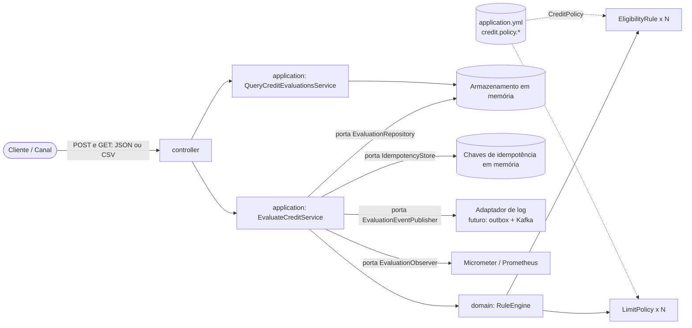
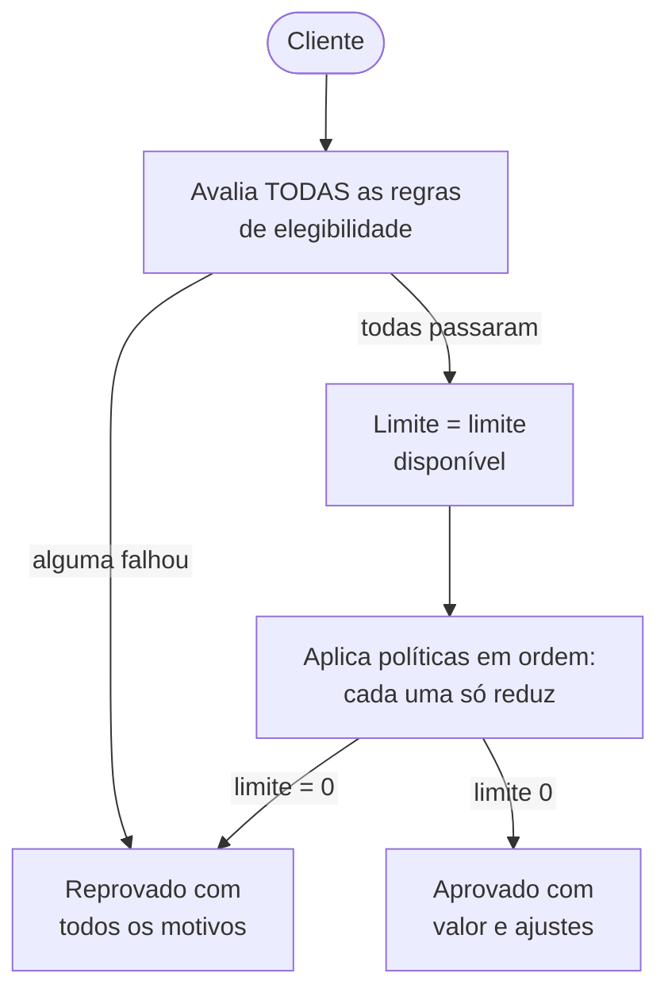
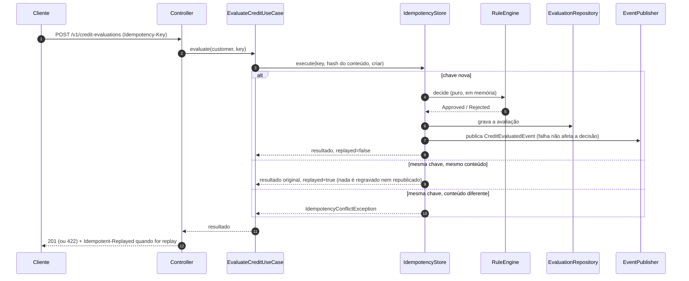

# Crédito Rotativo — Motor de Regras

Simula a avaliação e a liberação automática de crédito rotativo em cartão de crédito para uma lista de clientes:
aplica regras de elegibilidade, calcula o valor máximo liberável, gera relatório de aprovados e reprovados
e permite incluir regras novas **sem alterar o motor**.

Java 21 · Spring Boot 3.3 · Maven

## Como executar

Pré-requisitos: JDK 21 e Maven 3.9+.

```bash
# 1. Testes (unitários, propriedades, arquitetura e integração)
mvn test

# 2. Desafio de ponta a ponta, sem HTTP: lê sample-customers.json, imprime o relatório e grava report.csv
mvn spring-boot:run -Dspring-boot.run.profiles=demo

# 3. API REST
mvn spring-boot:run
```

### API

```bash
Apenas **POST** (cria avaliacoes) e **GET** (consulta). Não há PUT, PATCH nem DELETE: uma decisão de crédito é um
registro imutável e auditável, então não faz sentido editá-la ou apagá-la (retornam 405).

| Método | Rota | Descrição | Resposta |
|---|---|---|---|
| POST | `/v1/credit-evaluations` | Avalia um cliente (caminho online, meta < 1s) | 201 |
| POST | `/v1/credit-evaluations/batch` | Avalia uma lista de clientes (JSON) | 201 |
| POST | `/v1/credit-evaluations/batch/csv` | Avalia uma lista e devolve o relatório em CSV | 201 |
| GET | `/v1/credit-evaluations/{id}` | Consulta uma avaliação já realizada | 200 / 404 |
| GET | `/v1/credit-evaluations?decision=&page=&size=` | Lista paginada, da mais recente para a mais antiga; `decision` = `APPROVED` ou `REJECTED` (opcional); `size` de 1 a 100 | 200 / 400 |
| GET | `/v1/reports/credit-evaluations` | Relatório consolidado em JSON: aprovados, reprovados, valores e total liberado | 200 |
| GET | `/v1/reports/credit-evaluations/csv` | Mesmo relatório em CSV | 200 |

#### Idempotência (`Idempotency-Key`)

Os três POSTs aceitam o header opcional `Idempotency-Key`. É a proteção contra duplicidade por retry do cliente,
timeout de rede ou clique duplo, que num POST acontece mesmo sem mensageria.

| Situação | Resultado |
|---|---|
| Mesma chave + mesma requisição | Devolve **a mesma resposta** (201, mesmo `id`), com o header `Idempotent-Replayed: true`. Não reavalia e não grava outro registro |
| Mesma chave + requisição diferente | **422** (erro do cliente); nada é gravado |
| Chave usada no endpoint individual e depois no de lote | **422** (a operacao faz parte da comparação) |
| Chave inválida (vazia, > 128 caracteres, espacos, `;`, quebras de linha) | **400**, sem ecoar o valor |
| Sem o header | Comportamento normal: cada POST cria uma avaliação nova |

Como funciona: a chave é guardada junto com um **hash SHA-256** do conteúdo da requisição (o CPF completo nunca é 
armazenado). A verificação e a criação acontecem numa única seção crítica, então duas requisições simultâneas com a
mesma chave **não** criam duas avaliações (sem a race condition do "if existe, senão cria"). Se a criação falhar,
nada é gravado e o cliente pode repetir a mesma chave. A métrica `credit_idempotent_replays_total` conta os retries
absorvidos. Detalhes e limitações no [ADR-006](docs/adr/006-idempotency-key.md).

```bash
# Avaliação individual idempotente: repita este mesmo comando e o "id" será o mesmo
curl -si -X POST localhost:8080/v1/credit-evaluations -H 'Content-Type: application/json' \
  -H 'Idempotency-Key: pedido-0001' -d '{
  "name": "Ana Souza", "cpf": "12345678909", "creditScore": 820,
  "currentInvoice": 1200.00, "availableLimit": 8000.00, "latePayments": 0,
  "monthlySpending": [2800.00, 3000.00, 3100.00, 3200.00]
}'

# Lote de exemplo (JSON) e relatório em CSV
curl -s -X POST localhost:8080/v1/credit-evaluations/batch -H 'Content-Type: application/json' \
     -d @src/main/resources/sample-customers.json
curl -s -X POST localhost:8080/v1/credit-evaluations/batch/csv -H 'Content-Type: application/json' \
     -d @src/main/resources/sample-customers.json

# Consultas (GET)
curl -s localhost:8080/v1/credit-evaluations/<id>
curl -s 'localhost:8080/v1/credit-evaluations?decision=REJECTED&page=0&size=10'
curl -s localhost:8080/v1/reports/credit-evaluations
curl -s localhost:8080/v1/reports/credit-evaluations/csv
```
Erros seguem o padrão RFC 7807 (`ProblemDetail`) e nunca ecoam dados recebidos, como o CPF. 

Métricas e health: `/actuator/health/liveness`, `/actuator/health/readiness`, `/actuator/prometheus`.

## Resultado esperado do lote de exemplo

| Cliente | Decisão | Valor | Motivo |
|---|---|---|---|
| Ana | Aprovado | 4.000,00 | faixa 800+ libera 50% do disponível |
| Bruno | Aprovado | 1.680,00 | faixa 700+ (35% = 2.100) reduzida em 20% por 1 atraso |
| Carla | Reprovada | 0,00 | score 430 < 500; 4 atrasos > 2 |
| Diego | Reprovado | 0,00 | utilização do limite 90,5% > 85% |
| Elisa | Aprovada | 1.953,00 | 35% = 4.200 → teto de gastos 3.255 → 2 atrasos (−40%) |
| Fábio | Reprovado | 0,00 | pico de gastos: 4.500 > 2x a média anterior (1.050) |
| Gabriela | Aprovada | 14.749,99 | teto de gastos 1,5x média 9.833,33 (arredondado para baixo) |
| Hugo | Reprovado | 0,00 | histórico de 2 meses < 3; disponível 400 < 500 |

Total liberado: **R$ 22.382,99** (4 aprovados, 4 reprovados).

## Arquitetura

Monolito modular com arquitetura hexagonal (portas e adaptadores). O domínio é puro e não conhece web, banco nem métricas.
As **portas de saída** (`EvaluationRepository`, `IdempotencyStore`, `EvaluationEventPublisher`, `EvaluationObserver`) são interfaces
implementadas por adaptadores. Na **entrada**, o controller é o adaptador e chama os serviços de aplicação diretamente, sem interface
de caso de uso. A garantia está na direção das dependências, protegida pelo `ArchitectureTest`.


Fluxo da decisão:



Fluxo de um POST com `Idempotency-Key` (caminho online):


Pacotes: `controller` (entrada HTTP); `service` (serviços de aplicação que orquestram o fluxo);
`domain` (`model`, `rule`, `enums`; domínio puro, sem Spring); `application` (portas e tipos de aplicação:
`IdempotencyStore`, `EvaluationEventPublisher`, `EvaluationObserver`, `Outcome`, `Page`, `CreditReport` etc.);
`repository` (porta de armazenamento das avaliações); `messaging` (adaptador de eventos);
`infrastructure` (`config`, `exception`, `observability`, `persistence`, `request`, `response`).
O ArchitectureTest (ArchUnit) quebra o build se o domínio depender de qualquer outra camada ou se alguém depender do controller.

## Eventos de domínio (sem broker)

Cada avaliação criada publica um `CreditEvaluatedEvent` pela porta `EvaluationEventPublisher`. **Não há Kafka nem
RabbitMQ neste projeto**: o adaptador atual só escreve um log, sem dado pessoal. A porta existe para que, num banco,
antifraude, cobrança, analytics e auditoria possam ser avisados sem acoplar a decisão a um broker.

- A decisão é **síncrona** e independente de broker; falha ao publicar não derruba nem altera a decisão e é contabilizada
  em `credit_events_publish_failures_total`.
- Um replay idempotente ou o retry de um lote **não** republica eventos.
- O evento não leva nome nem CPF; leva `customerKey` (hash do CPF) como chave de partição. Em produção deve ser um HMAC
  com segredo em cofre, pois o SHA-256 simples pode ser revertido por força bruta (ADR-007).
- Produção: outbox na mesma transação da avaliação + despachante para o Kafka, com retry e DLQ (ADR-004 e ADR-007).

## Observabilidade

Métricas para **Prometheus**, `traceId` em logs e respostas de erro, e regras de alerta prontas. Catálogo completo,
SLOs, tabela de alertas e como verificar em [`docs/observability.md`](docs/observability.md).

- **Métricas** em `/actuator/prometheus`: `credit_evaluations_total{decision}` (volume e taxa de aprovação),
  `credit_rule_rejections_total{rule}`, `credit_evaluation_duration_seconds` (histograma com faixas de 50 ms, 200 ms e 1 s),
  `credit_idempotent_replays_total`, `credit_events_publish_failures_total`, além de HTTP e JVM. Nenhuma usa dado pessoal como rótulo.
- **`traceId`**: cada requisição recebe um id (ou reaproveita o `X-Trace-Id` do cliente, se tiver formato seguro). Ele aparece
  em toda linha de log, no header `X-Trace-Id` e no corpo de qualquer resposta de erro, para ligar o que o cliente viu ao log.
  É um identificador de correlação, **não** tracing distribuído (ADR-008).
- **Alertas** em [`observability/alerts.yml`](observability/alerts.yml): 11 alertas (latência p99, SLO de 1 s, erro 5xx,
  instância fora do ar, capacidade, heap, falha de evento e outros), incluindo o de **desvio da taxa de aprovação**, que
  detecta regra mal configurada sem nenhum erro técnico. Coleta em [`observability/prometheus.yml`](observability/prometheus.yml).

```bash
prometheus --config.file=observability/prometheus.yml       # com a aplicação em localhost:8080
curl -s localhost:8080/actuator/prometheus | grep '^credit_'
```

## Critérios de decisão (e por quê)

**Regras eliminatórias** (todas precisam passar). Limiares em `application.yml`:

| Regra | Critério padrão | Justificativa |
|---|---|---|
| MinimumScore | score ≥ 500 | score baixo indica risco elevado de inadimplência |
| MaxLatePayments | atrasos ≤ 2 | atraso recente é o preditor mais direto de inadimplência futura |
| InvoiceUtilization | fatura / limite total ≤ 85% | pouca margem para absorver o rotativo |
| SpendingBehavior | ≥ 3 meses de histórico e último mês ≤ 2x a média anterior | sem histórico não há base; pico abrupto sugere uso desordenado |
| MinimumAvailableLimit | limite disponível ≥ R$ 500 | abaixo disso o rotativo não é relevante |

**Políticas de limite** (aplicadas em sequência; cada uma só pode reduzir):

1. **ScoreBand**: 800+ → 50%, 700+ → 35%, 600+ → 20%, demais → 10% do limite disponível.
2. **SpendingCap**: no máximo 1,5x a média de gastos mensais.
3. **LatePaymentPenalty**: −20% por atraso (mínimo zero).
4. **PolicyCeiling**: teto absoluto de R$ 15.000.

Os limiares são **suposições de negócio** (o enunciado não os define) e estão todos parametrizados.

## Suposições declaradas

- O enunciado não informa o limite total do cartão; usamos `fatura atual + limite disponível` como estimativa.
- "Comportamento de gastos" = lista de gastos mensais, do mais antigo para o mais recente.
- Os clientes e CPFs de exemplo são fictícios (CPFs com dígitos verificadores válidos).
- O score segue a escala 0–1000.

## Como adicionar uma regra nova

Crie uma classe `@Component` que implemente `EligibilityRule` (ou `LimitPolicy`). O `RuleEngineConfig` injeta
todas as regras encontradas; **nenhum arquivo existente precisa mudar**. O teste
`RuleEngineTest.newRuleRequiresNoEngineChange` demonstra isso.

## Requisitos não funcionais: o que está implementado e o que é proposta

| Requisito | Implementado | Proposto (não implementado) |
|---|---|---|
| Latência < 1s | Decisão pura em memória, sem I/O; histograma `credit.evaluation.duration` com SLO de 1s | Teste de carga k6/Gatling com p99 |
| 10k avaliações/min (~167/s) | Aplicação stateless, threads virtuais, escala horizontal | HPA no Kubernetes; ingestão em lote via Kafka |
| Precisão e consistência | `BigDecimal` com arredondamento para baixo, decisão determinística e versionada, testes de fronteira e de propriedade; `Idempotency-Key` atômica nos POSTs | Persistência durável (hoje apenas em memória) e constraint única no banco como garantia final entre réplicas |
| Extensibilidade | Strategy + descoberta automática; política não consegue aumentar limite | Versionamento e hot reload de regras; shadow mode |
| Segurança / LGPD | CPF mascarado em respostas, relatórios e logs; validação de entrada; erros sem eco de dados; proteção contra CSV injection | OAuth2/JWT com escopos, mTLS, CPF com hash/AES-GCM em repouso, retenção e direitos do titular |
| Observabilidade | Métricas Micrometer/Prometheus (volume, aprovação, rejeição por regra, latência, replays, falhas de evento); `traceId` nos logs e erros; 11 alertas em PromQL; probes de health | Tracing distribuído (OpenTelemetry), logs em JSON, Alertmanager, dashboards como código |
| Resiliência | Falha segura por construção (sem faixa de score → zero; limite zero → reprovado); graceful shutdown | Resilience4j nas dependências externas, fail-closed, outbox + Kafka + DLQ (a porta de eventos já existe), 503 com Retry-After se o banco cair |

## Estratégia de testes

- **Unitários por regra e política**, com valores de fronteira (score 499/500, utilização 85,00%/85,01%, etc.).
- **Cenários de negócio** no motor, com valores calculados à mão, inclusive arredondamento e agregação de motivos.
- **Propriedades (jqwik)**: para qualquer cliente, limite aprovado > 0, ≤ disponível, ≤ teto; aprovado implica todas as regras passando; reprovação sempre explica; decisão determinística.
- **Arquitetura (ArchUnit)**: fronteiras entre camadas.
- **Integração (`@SpringBootTest` + MockMvc)**: contrato da API, validação, CPF mascarado, lote de exemplo com total conferido, CSV e métricas.
- **Próximos**: Testcontainers (Postgres/Kafka), mutation testing (PIT) nas regras, carga (k6), caos (banco indisponível).

## Limitações conhecidas

- Armazenamento **em memória**, limitado a 10.000 avaliações (`credit.store.max-entries`, descarta as mais antigas): os GETs
  funcionam enquanto a aplicação está no ar, mas os dados somem ao reiniciar e não são compartilhados entre réplicas.
  Persistência durável (PostgreSQL) é a principal evolução e só exige trocar o adaptador da porta `EvaluationRepository`.
- Idempotência **em memória**: vale só para a instância que recebeu a primeira requisição, some ao reiniciar, descarta as
  chaves mais antigas acima de 10.000 (`credit.idempotency.max-entries`) e não tem TTL. Com várias réplicas, um retry
  que caia em outra instância seria tratado como requisição nova. A solução de produção é uma constraint única em
  banco compartilhado (ADR-006).
- Os eventos só vão para o log; nenhum sistema downstream recebe nada até existir o adaptador de outbox + Kafka.
- Observabilidade sem tracing distribuído, sem logs em JSON e sem roteamento de alertas; as regras de alerta passaram só em validação de sintaxe, não foram executadas contra um Prometheus real (`docs/observability.md`, seção "Como verificar").
- Sem autenticação/autorização: proposta documentada, não implementada.
- Dados do cliente chegam na requisição; não há consulta a bureau de crédito (seria um mock com circuit breaker).
- Limiares fixos por versão de configuração; sem hot reload.

## Evoluções

Persistência com Flyway + PostgreSQL (avaliações e chaves de idempotência com constraint única e TTL) · outbox + Kafka para eventos
`CreditEvaluated` · Resilience4j · OAuth2/JWT · OpenTelemetry (tracing distribuído e logs em JSON) · versionamento de regras com shadow mode e
champion/challenger · backtesting com histórico · CQRS para relatórios · avaliação por modelo de ML como política adicional.

## Decisões de arquitetura (ADRs)

| ADR | Decisão |
|---|---|
| [001](docs/adr/001-monolito-modular-hexagonal.md) | Monolito modular com arquitetura hexagonal |
| [002](docs/adr/002-strategy-com-descoberta-automatica.md) | Strategy com descoberta automática, em vez de Chain of Responsibility ou motor externo |
| [003](docs/adr/003-precisao-monetaria-e-falha-segura.md) | `BigDecimal` com arredondamento para baixo e falha segura (fail-closed) |
| [004](docs/adr/004-caminho-sincrono-e-eventos-assincronos.md) | Decisão síncrona; persistência durável, outbox e Kafka como proposta |
| [005](docs/adr/005-api-post-e-get-com-armazenamento-em-memoria.md) | API só com POST e GET; resultados em memória |
| [006](docs/adr/006-idempotency-key.md) | `Idempotency-Key` atômica nos POSTs |
| [007](docs/adr/007-eventos-de-dominio-e-porta-de-publicacao.md) | Eventos de domínio atrás de uma porta, sem broker |
| [008](docs/adr/008-trace-id-por-filtro-e-opentelemetry-como-evolucao.md) | `traceId` por filtro simples; OpenTelemetry como evolução |

## Consequências ADR-001

Os casos de uso ficam no pacote `service` (`EvaluateCreditService`, `QueryCreditEvaluationsService`), seguindo a convenção do ecossistema Spring. Eles dependem apenas do domínio e das portas, nunca do controller, A nomenclatura port.in, port.out e adapter.in/out não foi adotada; os pacotes seguem a convenção controller, service, domain, repository, messaging e infrastructure.